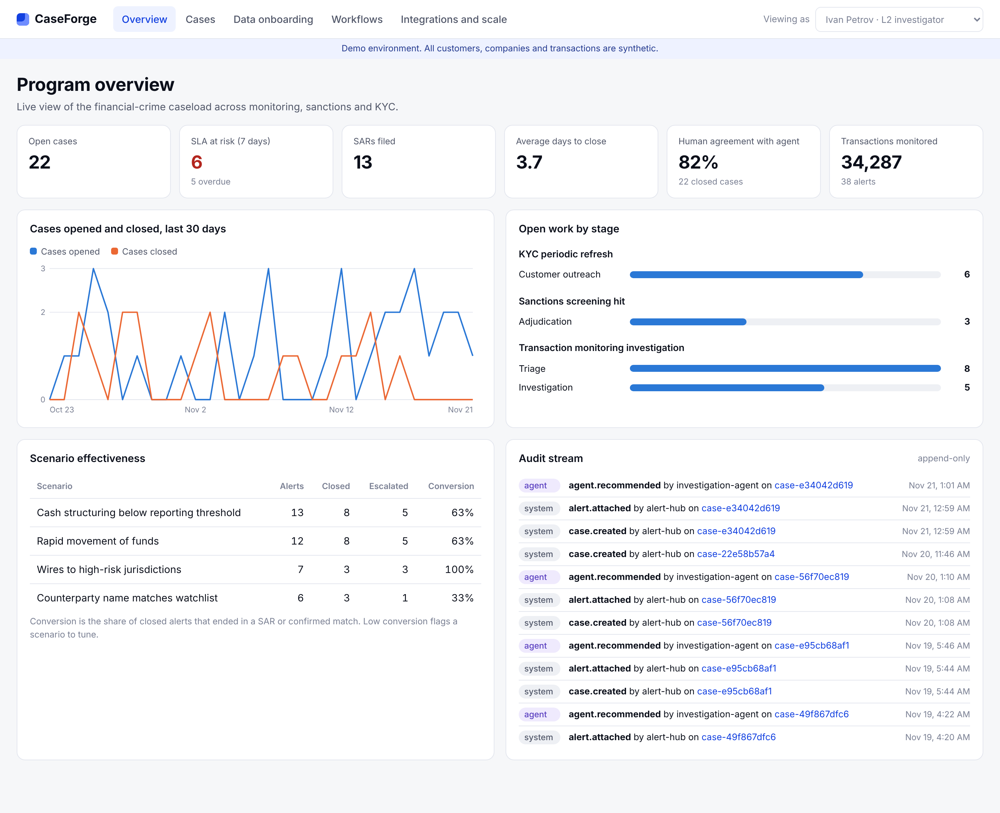

# CaseForge

A laptop-sized, working slice of an AI-first financial-crime case management platform. It ingests a bank feed,
maps it to a canonical model, runs monitoring scenarios, groups alerts into cases, has an agent prepare each
investigation, and lets people decide under role and four-eyes controls with a complete audit trail.

This is milestone 1 of a demo build. It is meant to be shown, not deployed. All data is synthetic.



## Run it on a Mac

Pick one. Both end at <http://localhost:8000>.

**Option A, Docker Desktop (Postgres):**

```bash
docker compose up --build
```

**Option B, no Docker (SQLite).** Needs [uv](https://docs.astral.sh/uv/) and Node 20+ (`brew install uv node`):

```bash
make run
```

The first start seeds about 300 customers, 34,000 transactions and 38 cases. `make seed` (or `make reset` for
Docker) restores that starting point before each demo. `make test` runs the backend tests.

For development, run `make dev-api` and `make dev-ui` in two terminals and open <http://localhost:5173>.

## A ten-minute demo

1. **Overview.** Start with the caseload: open cases, SLA risk, SARs filed, and the share of closed cases where
   the reviewer agreed with the agent. Point at scenario effectiveness: low conversion marks a rule to tune.
2. **Cases, then one investigation.** Open a transaction monitoring case in *Investigation*. The agent briefing
   is on the left with its recommendation, confidence and findings. Click a "sources" chip and the transaction
   table filters to the exact rows behind that finding. The narrative is already drafted and marked as an
   agent draft.
3. **Controls.** As Ivan (investigator), save the narrative and recommend a SAR. Then try to approve it: the
   button is blocked. Switch to Maya (MLRO) at the top right and file. The audit trail shows who did what,
   human or agent, in order. A filing record with a content hash is created.
4. **Data onboarding.** Profile the sample "legacy core" extract. Column names like `CUST_NO` and `DR_CR_IND`
   are mapped to the canonical model with a confidence and a reason. Load it: counts and amounts reconcile,
   nine defective rows are held with reasons, and three new cases appear with briefings ready.
5. **Workflows.** Each case type is a YAML file under `backend/case_types/`: states, transitions, roles,
   four-eyes rules, required evidence, SLAs and which agents run. Change a file, restart, and the workflow
   changes. No code.
6. **Integrations and scale.** Show what is live and what is planned, run the throughput check, and end on the
   table that maps each laptop component to its production counterpart.

To show overlay mode (sitting on top of an incumbent monitoring engine), push an alert from a terminal and
watch a case appear:

```bash
curl -X POST localhost:8000/api/alerts -H 'content-type: application/json' -d '{
  "source": "legacy-tm", "external_id": "LT-88213", "scenario": "rapid_movement",
  "party_id": "P10005", "score": 0.82, "explanation": "Vendor rule 12: funds in and out within 24h"}'
```

The full API reference is at <http://localhost:8000/docs>.

## What is real and what is not

| Area | In this build | Not yet |
|---|---|---|
| Ingestion | CSV feeds, profiling, mapping proposals, code-list translation, rejects, reconciliation | Streaming, CDC, ISO 20022 |
| Detection | Four scenarios (structuring, rapid movement, high-risk geography, watchlist name match), versioned and idempotent | Stream processing, ML models, a real sanctions list (the watchlist is fictional) |
| Alert intake | `POST /api/alerts` for outside engines, deduplicated, grouped per customer | Vendor-specific adapters |
| Cases | Config-driven workflows, role and four-eyes guards, SLAs, append-only audit | Durable workflow engine, timers, queues and skills routing |
| Agents | Multi-step investigation with cited findings, recommendation and draft narrative. Agents never move a case. | A language model. The provider is an offline rule-and-template implementation behind the `LLMProvider` interface, so the demo runs with no keys and no data leaving the laptop. |
| Filing | A hashed JSON filing record | FinCEN BSA XML, goAML |
| Identity | Persona switch (no login) | SSO, fine-grained authorization |
| Scale | Measured single-process throughput on your machine | Anything distributed. Do not quote the laptop figure as a production figure. |

## How the code is laid out

```
backend/app/
  domain/      canonical model and personas
  ingest/      connectors, mapping proposer, load and reconcile
  detection/   scenario registry and engine
  alerts/      alert hub: dedupe, group into cases, prioritise
  cases/       YAML case types, transition guards, narrative, filing
  agents/      provider interface, investigation steps, orchestrator
  reporting/   dashboard metrics
  api/         HTTP routes (the UI uses only these)
backend/case_types/   one YAML file per workflow
frontend/src/         React + TypeScript UI
```

Each replaceable part sits behind a small interface (`Connector`, `MappingProposer`, `LLMProvider`, the scenario
registry), so later milestones swap implementations without touching callers. The database is chosen by
`DATABASE_URL`; nothing in the code is tied to a cloud.

## Milestones

**1. Working slice (this build).** One process, one database, end-to-end story across ingestion, detection,
cases, agents, workflows and reporting.

**2. Real backbone, still on the laptop.** Kafka for events and the audit stream, Temporal for durable case
workflows and SLA timers, a model gateway with real providers (hosted and local) plus an evaluation set, an
MCP tool server for agents, and a live event-replay demo that shows sustained throughput.

**3. Enterprise surface.** Keycloak SSO and OpenFGA authorization, OpenSearch, entity resolution and a network
view, FinCEN BSA XML and goAML output, QA sampling, lookback and remediation projects, management reporting.

**4. Demo polish and breadth.** Fraud and KYC onboarding journeys, a workflow designer, tenant configuration,
guided demo mode, and a Helm chart so the same build runs on any Kubernetes cluster.

After that, the cloud build follows the reference architecture: per-tenant stamps, Flink, Iceberg, and the
SaaS, dedicated, client-cloud and air-gapped deployment modes.

## Screenshots

`node scripts/screenshots.mjs` regenerates `docs/screenshots/` from a running app (needs Playwright).
