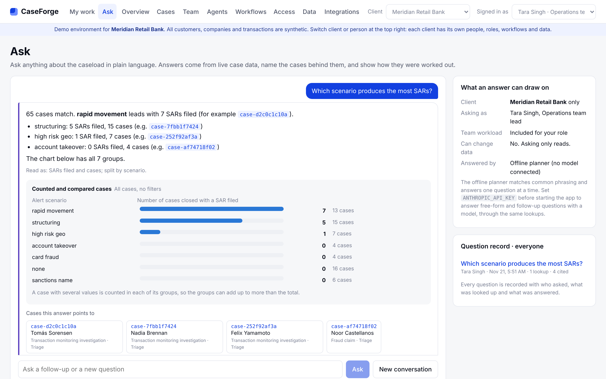
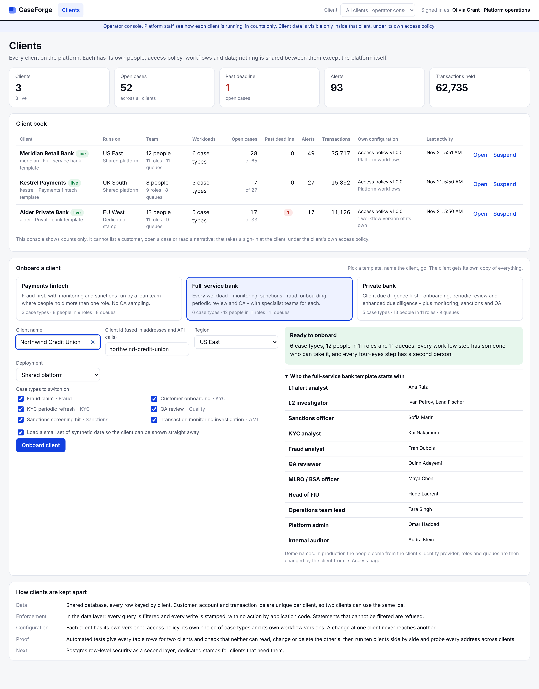

# CaseForge

A laptop-sized, working slice of an AI-first financial-crime case management platform. It ingests a bank feed,
maps it to a canonical model, runs monitoring scenarios, groups alerts into cases, has an agent prepare each
investigation, and routes the work through configurable workflows to the right people, under role, four-eyes
and stage-clock controls, with a complete audit trail. It runs many clients on one platform: each has its own
people, access policy, workflows and data, and a new client is onboarded from a template in about a minute.
Anyone can ask a question about the caseload in plain language and get an answer that names the cases behind it.

This is a demo build. It is meant to be shown, not deployed. All data is synthetic.







## Run it on a Mac

Pick one. Both end at <http://localhost:8000>.

**Option A, Docker Desktop (Postgres):**

```bash
docker compose up --build
```

**Option B, no Docker (SQLite).** Needs [uv](https://docs.astral.sh/uv/) and Node 20+ (`brew install uv node`):

```bash
make run
```

The first start (about ten seconds) seeds three clients of different kinds: Meridian Retail Bank (every
workload, twelve people), Kestrel Payments (fraud first, a lean team where people hold two roles) and Alder
Private Bank (due diligence first, with a workflow version of its own). Together they hold about 540 customers,
61,000 transactions and 120 cases, already worked to different stages by each client's own people. `make seed` (or `make reset` for
Docker) restores that starting point before each demo. `make test` runs the backend tests.

For development, run `make dev-api` and `make dev-ui` in two terminals and open <http://localhost:5173>.

## A fifteen-minute demo

The client and person pickers at the top right are the whole login. Steps 1 to 9 are at Meridian Retail Bank;
each says who to be. Steps 10 to 12 show the platform running several clients.

1. **My work, as Ivan Petrov (L2 investigator).** His own cases ordered by urgency, then unassigned work in
   his queue with a Claim button. Stage clocks and the regulatory deadline are separate columns.
2. **An investigation, still as Ivan.** Open a case in *Investigation*. The agent briefing is on the left with
   its recommendation and cited findings; click a "sources" chip and the transactions filter to the rows
   behind it. On the right, the steps are blocked until the stage tasks are ticked. Raise an information
   request to the customer and park the case: it moves to a waiting stage with its own clock.
3. **Approval, as Maya Chen (MLRO).** Open a case in *MLRO review*. An ordinary filing shows "Approve and file
   SAR". A case over $100,000 or on a politically exposed customer shows "Approve and send to Head of FIU"
   instead: the workflow itself routes it to a second approver (Hugo Laurent). Four-eyes rules stop anyone
   approving work they drafted or sent.
4. **Fraud, as Fran Dubois.** A different workflow on the same engine: a two-hour triage clock, customer
   contact as a waiting stage, and refunds above $5,000 routed to a lead (Tara Singh) for approval.
5. **Team, as Tara Singh (team lead).** Workload by person, queue backlogs, every case past its stage clock,
   and reassignment in one click. QA results sit alongside: one sampled closure failed QA and was reopened.
6. **Workflows, as Omar Haddad (admin).** Pick a case type and read it as a diagram with live case counts.
   Edit the definition (say, change the triage clock from 48 to 12 hours and raise the version), check the
   draft to see exactly what would change, and publish. New cases use the new version; open cases finish
   on the one they started with. A broken draft (unknown role, dead-end stage, bad condition) is refused
   with the reason.
7. **Access, as anyone.** The role and permission matrix, every workflow step against every role, people and
   queues. All of it is the client's own policy; nothing about roles is in code.
8. **Read-only, as Audra Klein (auditor).** Every case and audit trail opens; nothing can be changed.
9. **Data pipelines, as Omar.** Open Data. Three sources read Meridian's core-banking files from its
   landing zone: customers, accounts and daily transaction partitions in CSV, JSON lines and Parquet. Press
   "Run all sources". They run in dependency order; counts and amounts reconcile; one customer record is
   rejected and one transaction file is held whole because too many of its rows are unusable, with the
   rejected rows written to quarantine. Open the run's details to see each file. Run again: nothing loads
   twice. "Add a source" looks at a location, samples the newest file and proposes the mapping. The sample
   file loader and the throughput check are still on their own pages.

10. **A second client.** Switch the client to Kestrel Payments. Different people, different roles and queue
    names, three case types instead of six, no QA. Joy Tanaka holds two roles (MLRO and operations lead) and
    still cannot approve her own work. Customer `P10005` exists here too and is a different person.
11. **Changing access, as Pat Novak at Kestrel.** On Access, add a person or move a permission in the policy,
    raise the version and check the draft: the page lists exactly what would change. Try removing the only
    chief risk officer: refused, because a workflow Kestrel runs would have nobody for a step. Publish, and the
    change applies from the next click. Meridian's policy is untouched.
12. **Operator console.** Pick "All clients" in the client picker. Every client with its volumes, backlog and
    configuration, in counts only. Onboard a new client: choose a template, name it, and it is live with its
    own copy of the policy and a small set of sample data. Suspend it and its sign-ins stop at once.

13. **Ask anything, as Tara Singh at Meridian.** Open Ask and click "Which scenario produces the most SARs?".
    The answer leads with the figure, charts the breakdown, and links the cases behind it; "How this was
    answered" shows each lookup and its filters. Ask "Who has the most open work?", then switch to Ana Ruiz
    (an analyst) and ask it again: her role does not hold the team view, so the answer says so, and "What
    should I work on first?" lists only her own cases. Switch client and the same question gets that
    client's answer. Every question lands in the question record.

### Connecting a model to Ask

With no key the Ask page uses an offline planner: a phrase matcher that understands common questions (the
suggested ones and their variations), answers one question at a time, and says so when it cannot place a
question. To answer free-form and follow-up questions with a model:

```bash
export ANTHROPIC_API_KEY=...        # then start the app as usual
export ASK_MODEL=claude-opus-5-5    # optional; this is the default
```

The model never sees the database. It is handed five read-only lookups (breakdown, case list, case detail,
customer, team workload) that run as the person asking, inside their client, and it gets only the lookups that
person's role may use. Case ids in an answer are checked against what the lookups returned before they become
links. `ASK_PROVIDER=offline` forces the planner even when a key is set. Other providers (a model in the
client's own cloud, a local model) plug in behind the same interface in `backend/app/ask/gateway.py`.

To show overlay mode (sitting on top of an incumbent monitoring engine), push an alert from a terminal and
watch a case appear:

```bash
curl -X POST localhost:8000/api/alerts -H 'content-type: application/json' -d '{
  "source": "legacy-tm", "external_id": "LT-88213", "scenario": "rapid_movement",
  "party_id": "P10005", "score": 0.82, "explanation": "Vendor rule 12: funds in and out within 24h"}'
```

API calls are for one client. This demo reads it from an `X-Tenant` header (Meridian if absent) and the person
from `X-Persona`; a real deployment takes both from the sign-in token.

The full API reference is at <http://localhost:8000/docs>.

## What is real and what is not

| Area | In this build | Not yet |
|---|---|---|
| Ingestion | Pipelines that read customers, accounts and transactions from a client's registered storage locations, through one interface for S3, Azure Data Lake, Google Cloud Storage and local directories. CSV, JSON lines and Parquet, gzip, saved and versioned mappings, quality rules per source, whole-file quarantine with rejected rows written out, count and amount reconciliation, each file loaded once, lineage from a transaction back to its file, schedules with stale-source flags. No credentials are stored: each driver uses the workload's own identity. | S3 is tested against an emulated S3 API, not AWS. The Azure and Google drivers have never been run; only their addresses are checked. Schedules run from a simple in-process timer (`PIPELINE_SCHEDULER=1`, one process only) or when "Run what is due" is called, not from an orchestrator such as Airflow or Temporal. A file is read into memory whole, so very large files need splitting. A local file's fingerprint is size and modified time. Streaming, CDC, ISO 20022, mappings compiled to dbt or Flink SQL. |
| Detection | Four scenarios (structuring, rapid movement, high-risk geography, watchlist name match), versioned and idempotent | Stream processing, ML models, a real sanctions list (the watchlist is fictional) |
| Alert intake | `POST /api/alerts` for outside engines, deduplicated, grouped per customer | Vendor-specific adapters |
| Workflows | Six case types as versioned YAML: stages, queues, stage tasks, conditional steps, waiting stages, four-eyes, stage clocks with escalation, QA sampling with reopen. Checked and published from the UI. | Durable workflow engine (timers are swept, not scheduled), parallel branches, a drag-and-drop designer |
| People and access | Each client's own versioned policy: roles, permissions, queues, people (who may hold several roles), read-only roles. Edited and published from the UI with checks: a change is refused if it would strand a workflow or lock everyone out. Every person at every kind of client is tested against every workflow step. | SSO and people from the client's identity provider, attribute-based rules (for example by customer segment or country), a form-based editor |
| Clients | Shared database with every row keyed by client. Isolation is enforced in the data layer: queries are filtered and writes stamped automatically, and statements that cannot be filtered are refused. Per-client case types and workflow versions. Templates, one-step onboarding, suspend, and an operator console that shows counts only. | Postgres row-level security as a second layer, dedicated databases or stamps per client (the choice is recorded, not acted on), per-client encryption keys, usage metering, offboarding and data export |
| Information requests | Requests to customer, branch or relationship manager with due dates and overdue flags | Actually sending them (email, portal, secure message) |
| Agents | Thirteen agents declared in `backend/agents/catalog.yaml` (goal, tools, highest autonomy, the one thing each may do alone). Each client sets autonomy per agent and case type (off, assist, prepare, act within policy) in a versioned policy, with limits, a kill switch per agent and a challenger that runs in shadow. Agents use only declared tools; filing, closing, moving, approving and exiting are not tools at any level. Findings that cite no record are dropped. News reaches the adverse media agent only as typed fields from a tool-less extractor. Every step goes to a hash-chained ledger. At L3, triage may close a low-risk alert and the sanctions adjudicator may discount a weak hit, only under settings whose evaluation on the client's own history passed, with a sampled human check and reopening. Evaluation, lookback, tuning advisor, case copilot, agreement rates per reviewer and a documentation pack for model risk. | The specialists are rule-based by default. `AGENT_MODE=model` runs them as tool loops on the model behind the gateway with the rules as fallback; that path is tested only against a scripted stand-in, never a live model. The extractor and the copilot are pattern-based, not language models, so the extractor's removal of manipulative text is a keyword filter backed by the structure (typed fields only), not a guarantee. Golden sets are the client's own closed cases, which in the demo are a few dozen synthetic ones. The orchestrator is in-process, not Temporal; tools are Python functions, not MCP servers. The ledger is tamper-evident, not tamper-proof: it lives in the same database. |
| Ask anything | Plain-language questions answered through a fixed vocabulary of 31 fields and 9 measures, never SQL. Answers are limited to the asker's client, team workload follows the client's own access policy, cited cases are verified, and every question is recorded. Hosted-model provider with tool use, plus an offline planner so the demo needs no key. | The hosted-model path has only been run against a stand-in client here, never a live model: its request shape and reply handling are tested, answer quality is not. Checking figures in an answer (only case ids are checked). Streaming. Per-role limits on which cases a person may see (everyone at a client sees all of its cases, as on the Cases page). Questions about transactions outside alerted activity. Spend limits. |
| Filing | A hashed JSON filing record | FinCEN BSA XML, goAML |
| Identity | Client and person pickers (no login). Anyone can pick any client or the operator console. | SSO; the client and person come from the token |
| Scale | Measured single-process throughput on your machine | Anything distributed. Do not quote the laptop figure as a production figure. |

14. **Agents, as Omar Haddad at Meridian.** Open Agents. Every agent prepares and recommends; none acts alone. Set the
    sanctions adjudicator to L3 on screening hits and try to publish: refused until those settings are evaluated.
    Set the discount limit to 0.95 and evaluate the draft: it fails, because it would have discounted a true match.
    At 0.9 it passes; publish. Run the lookback and the tuning review. Switch an agent off with a reason and re-run
    a briefing: the step is gone and says why. Download the documentation pack. Then open a case as Ivan and ask
    the copilot why the recommendation is what it is, and to draft a request to the customer.

## How the code is laid out

```
backend/app/
  domain/      canonical model, access policy
  storage/     object storage behind one interface: S3, Azure Data Lake, Google Cloud Storage, local
  ingest/      file formats, datasets, mapping proposer, pipelines (discover, validate, load, reconcile,
               detect), storage locations per client, the sample file loader
  detection/   scenario registry and engine
  alerts/      alert hub: dedupe, group into cases, prioritise
  cases/       case type registry, transition guards, conditions, tasks, assignment,
               information requests, timers, QA sampling, publishing
  agents/      catalog, per-client policy, runtime, toolbox and extractor, ledger, alert triage, evaluation,
               copilot, lookback and tuning, oversight, model-backed mode
  ask/         ask anything: query vocabulary, read-only tools, model gateway and providers,
               answer loop with citation checks and the question record
  reporting/   dashboard metrics
  tenancy.py   client isolation: session binding, automatic filtering and stamping
  tenants/     client registry, templates, onboarding, access policy administration
  api/         HTTP routes (the UI uses only these)
backend/case_types/   the workflow library: one YAML file per case type
backend/agents/       the agent catalog: one declaration per agent
backend/access/       starting access policies: permissions, roles, queues, people
backend/templates/    client templates: a starting policy plus a set of case types
frontend/src/         React + TypeScript UI
```

Each replaceable part sits behind a small interface (`ObjectStore`, `Connector`, `MappingProposer`, `LLMProvider`, the scenario
registry, and `ChatModel` for the model that answers questions), so later milestones swap implementations without touching callers. The database is chosen by
`DATABASE_URL`; nothing in the code is tied to a cloud.

## Milestones

**1. Working slice (done).** One process, one database, end-to-end story across ingestion, detection, cases,
agents and reporting.

**2. Workflows and people (done).** The workflow engine, twelve people, queues, access policy, fraud and
onboarding journeys, QA, the workflow diagram and editor.

**3. Multi-tenancy (done).** Isolated data per client, per-client access policy and workflow versions, templates
and onboarding, a client switcher and an operator console. Tested with ten clients side by side.

**4. Ask anything (done).** Questions across the whole caseload in plain language, answered through governed
lookups, citing the cases behind them and limited to what the asker may see. A model gateway with a hosted
provider and an offline planner. Still to come here: a live-model evaluation run, streaming, and a local model.

**5. Data pipelines (done).** Sources in object storage (S3, ADLS, GCS) behind one cloud-neutral interface,
pipelines in dependency order, saved mappings per source, data-quality gates, quarantine and lineage. File
upload remains only for samples. Still to come here: a first run against real cloud accounts, an orchestrator
for schedules, streaming and CDC.

**6. Agent layer (done).** The full roster, the autonomy dial per client, agents that act inside evaluated limits,
the ledger, evaluation against the client's own decisions, challenger in shadow, copilot, lookback, tuning and
oversight. Still to come here: a run against a live model, Temporal for durability, tools as MCP servers.

**7. Enterprise breadth.** Entity resolution and a network view, search, regulatory filing formats, lookback
projects, management reporting, SSO.

**8. Production backbone.** Kafka, Temporal, Flink, a Helm chart, then the cloud build on the reference
architecture: per-client stamps and the SaaS, dedicated, client-cloud and air-gapped deployment modes.

## Screenshots

`node scripts/screenshots.mjs` regenerates `docs/screenshots/` from a running app (needs Playwright).
