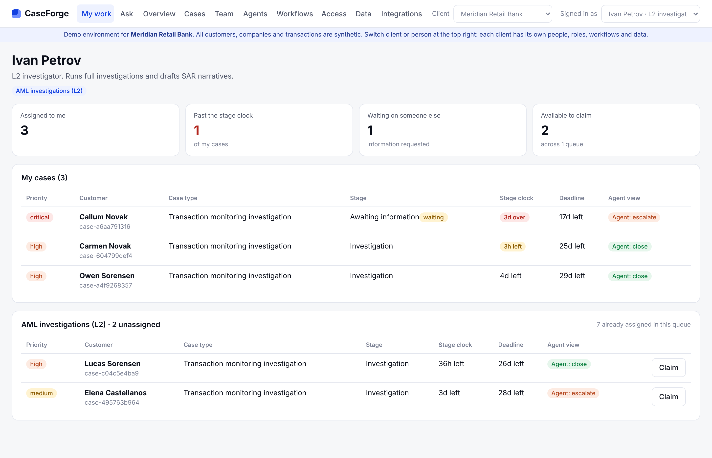
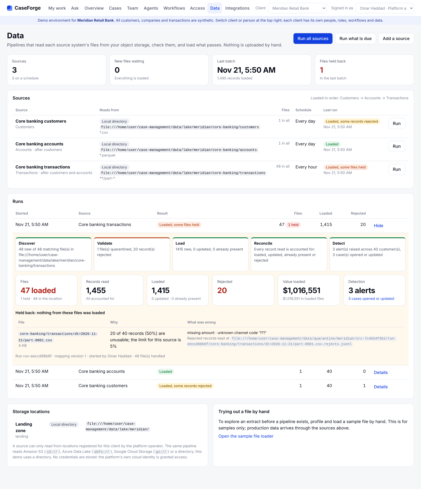
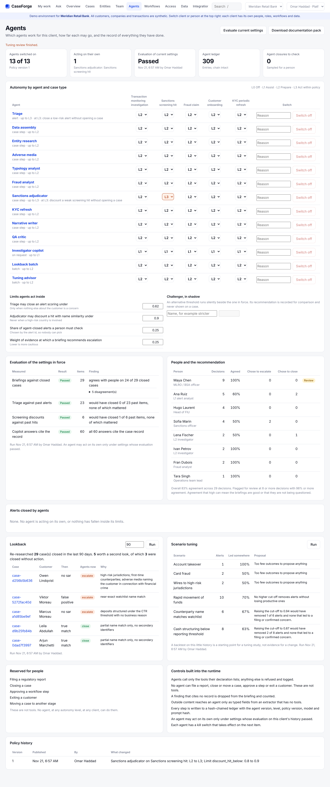

# CaseForge

A laptop-sized, working slice of an AI-first financial-crime case management platform. It ingests a bank feed,
maps it to a canonical model, runs monitoring scenarios, groups alerts into cases, has an agent prepare each
investigation, and routes the work through configurable workflows to the right people, under role, four-eyes
and stage-clock controls, with a complete audit trail. It runs many clients on one platform: each has its own
people, access policy, workflows and data, and a new client is onboarded from a template in about a minute.
Anyone can ask a question about the caseload in plain language and get an answer that names the cases behind it.

This is a demo build. It is meant to be shown, not deployed. All data is synthetic.







## Run it on a Mac

Pick one. Both end at <http://localhost:8000>.

**Option A, Docker Desktop (Postgres):**

```bash
docker compose up --build
```

**Option B, no Docker (SQLite).** Needs [uv](https://docs.astral.sh/uv/) and Node 20+ (`brew install uv node`):

```bash
make run
```

The first start (about ten seconds) seeds three clients of different kinds: Meridian Retail Bank (every
workload, twelve people), Kestrel Payments (fraud first, a lean team where people hold two roles) and Alder
Private Bank (due diligence first, with a workflow version of its own). Together they hold about 540 customers,
61,000 transactions and 120 cases, already worked to different stages by each client's own people. `make seed` (or `make reset` for
Docker) restores that starting point before each demo. `make test` runs the backend tests. They run on SQLite
with foreign keys enforced; to run the Postgres start-up test as well, point `TEST_POSTGRES_URL` at a disposable
database (everything in it is dropped).

**The event backbone.** Without it, events wait in the outbox table and nothing else changes. `make backbone`
starts the demo with Kafka, the outbox relay, the stream consumers and the Iceberg lake; `make backbone-cdc` has Debezium publish the
outbox instead of the relay, `make full` adds OpenSearch, and `make streaming` adds an Apache Flink cluster for stream detection (`deploy/flink/README.md`). None of them has been started anywhere yet, so treat the first run as a test. Without
Docker, point the API at any broker: `EVENT_BUS_URL=kafka://localhost:9092 BACKBONE_WORKERS=1 make run`. From the Mac,
the Compose broker is `localhost:29092`; publish a canonical transaction as JSON to `caseforge.meridian.transactions`
and watch the Integrations page. To run the broker tests, set `TEST_KAFKA_URL=kafka://localhost:29092`.

For development, run `make dev-api` and `make dev-ui` in two terminals and open <http://localhost:5173>.

**Sign-in.** By default there is no login: pickers at the top right choose the client and the person. To see
single sign-on instead, start the API with `AUTH_MODE=oidc DEV_IDP=1` (for example
`cd backend && AUTH_MODE=oidc DEV_IDP=1 uv run uvicorn app.main:app --port 8000`). The pickers disappear, every
request needs a signed token, and "signing in" sends you through a small built-in identity provider that stands
in for each client's own. To use a real provider (Keycloak, Entra ID, Okta), leave `DEV_IDP` off and register
each client's issuer: `PUT /api/platform/tenants/{id}/identity`.

## A fifteen-minute demo

The client and person pickers at the top right are the whole login. Steps 1 to 9 are at Meridian Retail Bank;
each says who to be. Steps 10 to 12 show the platform running several clients. Workflows, Lists, Detection,
Access, Data, Integrations and Governance are under Setup in the top bar.

1. **My work, as Ivan Petrov (L2 investigator).** His own cases ordered by urgency, then unassigned work in
   his queue with a Claim button. Stage clocks and the regulatory deadline are separate columns.
2. **An investigation, still as Ivan.** Open a case in *Investigation*. The agent briefing is on the left with
   its recommendation and cited findings; click a "sources" chip and the transactions filter to the rows
   behind it. On the right, the steps are blocked until the stage tasks are ticked. Raise an information
   request to the customer and park the case: it moves to a waiting stage with its own clock.
3. **Approval, as Maya Chen (MLRO).** Open a case in *MLRO review*. An ordinary filing shows "Approve and file
   SAR". A case over $100,000 or on a politically exposed customer shows "Approve and send to Head of FIU"
   instead: the workflow itself routes it to a second approver (Hugo Laurent). Four-eyes rules stop anyone
   approving work they drafted or sent.
4. **Fraud, as Fran Dubois.** A different workflow on the same engine: a two-hour triage clock, customer
   contact as a waiting stage, and refunds above $5,000 routed to a lead (Tara Singh) for approval.
5. **Team, as Tara Singh (team lead).** Workload by person, queue backlogs, every case past its stage clock,
   and reassignment in one click. QA results sit alongside: one sampled closure failed QA and was reopened.
6. **Workflows, as Omar Haddad (admin).** Pick a case type and read it as a diagram with live case counts.
   Edit the definition (say, change the triage clock from 48 to 12 hours and raise the version), check the
   draft to see exactly what would change, and publish. New cases use the new version; open cases finish
   on the one they started with. A broken draft (unknown role, dead-end stage, bad condition) is refused
   with the reason.
7. **Access, as anyone.** The role and permission matrix, every workflow step against every role, people and
   queues. All of it is the client's own policy; nothing about roles is in code.
8. **Read-only, as Audra Klein (auditor).** Every case and audit trail opens; nothing can be changed.
9. **Data pipelines, as Omar.** Open Data. Three sources read Meridian's core-banking files from its
   landing zone: customers, accounts and daily transaction partitions in CSV, JSON lines and Parquet. Press
   "Run all sources". They run in dependency order; counts and amounts reconcile; one customer record is
   rejected and one transaction file is held whole because too many of its rows are unusable, with the
   rejected rows written to quarantine. Open the run's details to see each file. Run again: nothing loads
   twice. "Add a source" looks at a location, samples the newest file and proposes the mapping. The sample
   file loader and the throughput check are still on their own pages.

10. **A second client.** Switch the client to Kestrel Payments. Different people, different roles and queue
    names, three case types instead of six, no QA. Joy Tanaka holds two roles (MLRO and operations lead) and
    still cannot approve her own work. Customer `P10005` exists here too and is a different person.
11. **Changing access, as Pat Novak at Kestrel.** On Access, add a person or move a permission in the policy,
    raise the version and check the draft: the page lists exactly what would change. Try removing the only
    chief risk officer: refused, because a workflow Kestrel runs would have nobody for a step. Publish, and the
    change applies from the next click. Meridian's policy is untouched.
12. **Operator console.** Pick "All clients" in the client picker. Every client with its volumes, backlog and
    configuration, in counts only. Onboard a new client: choose a template, name it, and it is live with its
    own copy of the policy and a small set of sample data. Suspend it and its sign-ins stop at once.

13. **Ask anything, as Tara Singh at Meridian.** Open Ask and click "Which scenario produces the most SARs?".
    The answer leads with the figure, charts the breakdown, and links the cases behind it; "How this was
    answered" shows each lookup and its filters. Ask "Who has the most open work?", then switch to Ana Ruiz
    (an analyst) and ask it again: her role does not hold the team view, so the answer says so, and "What
    should I work on first?" lists only her own cases. Switch client and the same question gets that
    client's answer. Every question lands in the question record.

### Connecting a model to Ask

With no key the Ask page uses an offline planner: a phrase matcher that understands common questions (the
suggested ones and their variations), answers one question at a time, and says so when it cannot place a
question. To answer free-form and follow-up questions with a model:

```bash
export ANTHROPIC_API_KEY=...        # then start the app as usual
export ASK_MODEL=claude-opus-5-5    # optional; this is the default
```

The model never sees the database. It is handed five read-only lookups (breakdown, case list, case detail,
customer, team workload) that run as the person asking, inside their client, and it gets only the lookups that
person's role may use. Case ids in an answer are checked against what the lookups returned before they become
links. `ASK_PROVIDER=offline` forces the planner even when a key is set. Other providers (a model in the
client's own cloud, a local model) plug in behind the same interface in `backend/app/ask/gateway.py`.

To show overlay mode (sitting on top of an incumbent monitoring engine), push an alert from a terminal and
watch a case appear:

```bash
curl -X POST localhost:8000/api/alerts -H 'content-type: application/json' -d '{
  "source": "legacy-tm", "external_id": "LT-88213", "scenario": "rapid_movement",
  "party_id": "P10005", "score": 0.82, "explanation": "Vendor rule 12: funds in and out within 24h"}'
```

API calls are for one client. In demo mode it is read from an `X-Tenant` header (Meridian if absent) and the
person from `X-Persona`. With `AUTH_MODE=oidc` both come from the sign-in token and those headers are ignored.
`POST /api/alerts` is a system calling in, so it has no person's view: it sees every case of the client.

The full API reference is at <http://localhost:8000/docs>.

## What is real and what is not

| Area | In this build | Not yet |
|---|---|---|
| Ingestion | Pipelines that read customers, accounts and transactions from a client's registered storage locations, through one interface for S3, Azure Data Lake, Google Cloud Storage and local directories. CSV, JSON lines and Parquet, gzip, saved and versioned mappings, quality rules per source, whole-file quarantine with rejected rows written out, count and amount reconciliation, each file loaded once, lineage from a transaction back to its file, schedules with stale-source flags. No credentials are stored: each driver uses the workload's own identity. | S3 is tested against an emulated S3 API, not AWS. The Azure and Google drivers have never been run; only their addresses are checked. Schedules run from a simple in-process timer (`PIPELINE_SCHEDULER=1`, one process only) or when "Run what is due" is called, not from an orchestrator such as Airflow or Temporal. A file is read into memory whole, so very large files need splitting. A local file's fingerprint is size and modified time. Capture from a client's core database (CDC), ISO 20022, mappings compiled to dbt or Flink SQL. Streaming is the next row. |
| Event backbone | Every audit event and every new alert is written to an outbox table in the same transaction as the change, as a CloudEvents 1.0 message, and published to the client's own topics (`caseforge.<client>.case-events`, `.alerts`). One bus interface with two adapters: in-process, and Kafka or anything that speaks its protocol (connection security is plain client properties in `KAFKA_CONFIG`). Two publishers that send identical bytes: a built-in relay (at least once, in order per case or customer, several relays share work on Postgres), or Debezium reading the database log (`deploy/debezium/`). Inbound, each client's `transactions` and `alerts-in` topics are consumed in micro-batches through the same loaders and detection the file pipelines use; a redelivered batch changes nothing, and a record that cannot load goes to the client's dead-letter topic with the reason. The Integrations page shows each client its own backlog and stream totals. **Run for real here:** the bus, relay, consumers and worker against an Apache Kafka 3.9.1 broker, and Debezium 3.0.8 on Kafka Connect against Postgres 16, checked message for message against the relay (`tests/test_kafka.py`, `tests/test_cdc.py`). | The CI workflow has run on GitHub, including the Postgres start-up test and the broker tests against service containers. **Never started:** the Docker Compose services for Kafka, the worker and Debezium (`make backbone`, `make backbone-cdc`), because the build environment has no Docker daemon; their first run is on your Mac. Not run against a managed service (MSK, Event Hubs, Confluent Cloud) or with TLS and SASL. No schema registry: messages are JSON with no enforced schema. No per-client quotas or ACL set-up, so who may write to a client's inbound topic is the broker's configuration, not the application's. The relay orders by row id, which can differ from commit order when transactions overlap; Debezium does not have that gap. The application's own consumers work in Python micro-batches, so their detection re-reads each touched customer's history from the database: correct, and not the billion-a-day design. One rule also runs as a Flink job (see "Stream detection on Flink"). Entity resolution and the payment network are not refreshed from the stream; they catch up on the next file pipeline run. Events about restricted cases are published like any other: a consumer of the bus is a system, and the bus has no per-person visibility. No replay tool for the dead-letter topic. |
| History on the lake | With `LAKE_CATALOG` set, every message on a client's case-event, alert and transaction topics is also written to Apache Iceberg tables in that client's own namespace, partitioned by day. The catalog is configuration: a SQL catalog on a laptop or in the demo's Postgres, a REST catalog (Polaris, Nessie) in a deployment. Each batch is committed together with the bus positions it reached, so after a crash a redelivered message is recognised and written once. A table can be read as it stood at any earlier commit. The Integrations page lists each client's tables, rows and commits. **Run for real here:** real Iceberg tables through pyiceberg 0.12 with SQL catalogs on SQLite and Postgres 16 and a local warehouse, filled from a real Kafka broker. | Never run against a REST catalog or against object storage (S3, ADLS, GCS): only a local directory. No compaction or snapshot expiry, so small files and commits accumulate. No schema evolution. Transactions loaded by the file pipelines do not reach the lake, only those that arrive on the stream; well-formed stream transactions are kept as received, including ones the loader set aside. Nothing reads the lake yet: the management report, backtests and lookbacks still run on the operational store, and there is no query engine (Trino, Spark, DuckDB) wired in. No tokenisation of identifiers at landing and no per-client encryption keys. The first run of the Compose set-up (catalog in Postgres, tables on a volume) is still to come. |
| Detection | Four scenarios (structuring, rapid movement, high-risk geography, watchlist name match), versioned and idempotent, run after each file load and after each micro-batch from the transaction stream | Only structuring also runs on a stream processor (the Flink row below); the other three do not. ML models, a real sanctions list (the watchlist is fictional) |
| Alert intake | `POST /api/alerts` or the client's `alerts-in` topic for outside engines, deduplicated, grouped per customer | Vendor-specific adapters |
| Workflows | Six case types as versioned YAML: stages, queues, stage tasks, conditional steps, waiting stages, four-eyes, stage clocks with escalation, QA sampling with reopen. Checked and published from the UI. | Durable workflow engine (timers are swept, not scheduled), parallel branches, a drag-and-drop designer |
| Casework at volume | Per-client code lists (closing reasons, QA criteria and weights, QA root causes, hibernation rules), edited on the Lists page and retired rather than deleted. Closing without a report needs a reason the client offers for that outcome. Bulk claim, reassign and move, where each case passes its own checks and refusals change nothing. Merging two open cases about one customer. QA scorecards with a pass mark, and a findings report by person, criterion, root cause and agent advice. Weak alerts that wait for a second alert, join its case, or close with the rule on record. | Approval of list changes by a second person, list versions, case splitting, undoing a merge, scheduled sweeps (waiting alerts close when the clock sweep runs) |
| KYC depth | A risk rating per customer from the client's own factors, points and bands (edited on Lists), showing the evidence for each factor. Raising a rating takes effect at once; lowering one waits for a second person holding `approve_risk`, never the proposer. Ownership structures as versions: effective shares multiplied down every chain, beneficial owners at the client's threshold or by control, untraced shares reported, and flags for trusts and nominees, loops, depth, politically exposed or unverified owners. A document store behind the same storage interface as the pipelines (`EVIDENCE_URL`), with a SHA-256 fingerprint checked on every read, a tamper-evident custody log, verification, expiry, and redacted copies of text documents. Flow of funds per customer or per case under resolved names. Events between reviews (rating rose, owners changed, a document expired, a SAR was filed, a sanctions match confirmed) open or join a review, and a schedule shows who is due one. | Identity and document verification vendors, registry lookups for ownership, OCR and redaction of scans and PDFs, virus scanning of uploads, encryption keys per client, a customer portal for collecting documents. The periodic review backlog in the demo comes from synthetic onboarding dates. |
| Fraud and sanctions depth | Watchlists per client, loaded as versions from CSV or JSON: each load is compared with what is held, removed names are kept as history, and every customer and recent payment is screened again. The client's own do-not-deal list is screened the same way. False-match exemptions with two people, an end date, and automatic ending when the list entry changes; identical names cannot be exempted. Holds on a payment, account, card or online access, with a review clock per reason; a sanctions hold is released, blocked or rejected only by a second person, and a case cannot close while a hold is active. Blocked and rejected payments produce a report to the authority through the same reports machinery, due in ten business days. Confidential searches for law enforcement requests, visible only to people with the permission, opening no case. Fraud step-up checks on a hold, and disputes with clocks per payment kind for the customer's credit, the recovery (chargeback, return, recall) and the final answer, with loss and recovery worked out per dispute and by cause. | The lists are a fictional demo list: no feed from OFAC, the UN, the EU, HMT or a commercial list vendor. Holds are records here; nothing tells a payment engine or core banking system to stop or release money. Reports are rendered and sent through the simulated channel, not OFAC's own reporting system, and the annual report of blocked property is not built. No card network chargeback or ACH return connection. Business days skip weekends only, not public holidays. Step-up checks record an outcome and send nothing to the customer. Sharing between institutions (314(b)) is not built. |
| Detection tuning and lookbacks | Each client's own settings per scenario, within the range the scenario declares, as numbered revisions holding the complete settings. A change is run against the past year first: how many alerts would not have been raised, how many of those led to a filing or a confirmed concern (listed by customer), and how many would be new. One person proposes with the backtest attached, another approves; approving a change that would have lost alerts that mattered, or switching a scenario off, takes a written reason. Alerts are stamped with the revision that raised them. Lookback projects: a past period run again through one scenario on chosen settings, counted before anything is raised, raising only what was never alerted, with every alert going to a person (no agent closure, no waiting rule), progress by case, a second person's sign-off with frozen figures, and a report to download. | Backtests and lookbacks run in the application process over the operational store, which suits the demo's volumes; at production scale they belong on the lake and the stream processor. A backtest compares alerts by customer and window, so a change to how windows are counted is approximate. No statistical above-the-line and below-the-line sampling, no segment-specific thresholds, no champion and challenger runs. Scenarios are still code: a client tunes them and switches them on or off, and does not author new ones. |
| Management reporting and governance | A monthly management report counted from the operational store: volumes, backlog at month end, time to close and deadlines met, outcomes, reports to regulators and how many were late, stage deadlines missed, open cases by age, each scenario's yield, each person's closures with QA beside them, fraud losses and sanctions decisions, with six months of trend, a spreadsheet export and a committee paper. A change register that reads every area's own version history (workflows, access, agents, detection, screening lists, reference lists) into one list showing the second person where there was one. Access recertification: a snapshot of who holds what, flags for people holding both sides of a control or showing no case activity, a decision on each person by someone else, and changes asked for tracked until the access policy shows them. Audit search across cases by person, event, case, date and words, limited to the cases the reader may open, with export. | The report is computed on request in the application, which suits the demo's volumes; at scale it belongs on the lake with a BI tool on top, and there is no scheduled delivery or report builder. Reference lists keep only their latest save, so the register shows one line for each. A recertification records decisions and does not edit the access policy or the client's identity provider. Last activity means case activity only: sign-ins are not recorded. No records retention schedule, legal hold or policy attestation tracking. |
| People and access | Each client's own versioned policy: roles, permissions, queues, people (who may hold several roles), read-only roles. Edited and published from the UI with checks: a change is refused if it would strand a workflow or lock everyone out. Every person at every kind of client is tested against every workflow step. | People and group membership synced from the client's identity provider (SCIM); today the provider proves who someone is and the policy on the Access page says what they may do. A form-based editor. |
| Case visibility | Each role can be limited to its own queues, its own cases, or some case types; people keep cases they own or have worked on, and someone with several roles sees what any of them shows. Restricted cases are hidden from everyone not cleared, including their former owner, team leads and administrators, and cases opened from a restricted case inherit it. Enforced in the data layer, so lists, case pages, actions, the event feed, dashboards, the agent ledger and Ask all follow it; a hidden case answers "not found". Tested by signing in as every person at every client and checking every case against an independent statement of the rule. | Customers and transactions are not hidden by this rule, only cases and what hangs off them, so the Data pages and a customer lookup in Ask still show a customer whose case is restricted. Alerts closed by an agent before any case existed are visible to all. Rules by customer attribute (segment, country, relationship manager's own book). Break-glass access with a reason. Postgres row-level security as a second layer. A restricted case stays in its workflow, so someone cleared must also hold the role for the next step. |
| Clients | Shared database with every row keyed by client. Isolation is enforced in the data layer: queries are filtered and writes stamped automatically, and statements that cannot be filtered are refused. Per-client case types and workflow versions. Templates, one-step onboarding, suspend, and an operator console that shows counts only. | Postgres row-level security as a second layer, dedicated databases or stamps per client (the choice is recorded, not acted on), per-client encryption keys, usage metering, offboarding and data export |
| Information requests | Requests to customer, branch or relationship manager with due dates and overdue flags | Actually sending them (email, portal, secure message) |
| Agents | Thirteen agents declared in `backend/agents/catalog.yaml` (goal, tools, highest autonomy, the one thing each may do alone). Each client sets autonomy per agent and case type (off, assist, prepare, act within policy) in a versioned policy, with limits, a kill switch per agent and a challenger that runs in shadow. Agents use only declared tools; filing, closing, moving, approving and exiting are not tools at any level. Findings that cite no record are dropped. News reaches the adverse media agent only as typed fields from a tool-less extractor. Every step goes to a hash-chained ledger. At L3, triage may close a low-risk alert and the sanctions adjudicator may discount a weak hit, only under settings whose evaluation on the client's own history passed, with a sampled human check and reopening. Evaluation, lookback, tuning advisor, case copilot, agreement rates per reviewer and a documentation pack for model risk. | The specialists are rule-based by default. `AGENT_MODE=model` runs them as tool loops on the model behind the gateway with the rules as fallback; that path is tested only against a scripted stand-in, never a live model. The extractor and the copilot are pattern-based, not language models, so the extractor's removal of manipulative text is a keyword filter backed by the structure (typed fields only), not a guarantee. Golden sets are the client's own closed cases, which in the demo are a few dozen synthetic ones. The orchestrator is in-process, not Temporal; tools are Python functions, not MCP servers. The ledger is tamper-evident, not tamper-proof: it lives in the same database. |
| Ask anything | Plain-language questions answered through a fixed vocabulary of 31 fields and 9 measures, never SQL. Answers are limited to the asker's client and to the cases the asker may see, team workload follows the client's own access policy, cited cases are verified, and every question is recorded. Hosted-model provider with tool use, plus an offline planner so the demo needs no key. | The hosted-model path has only been run against a stand-in client here, never a live model: its request shape and reply handling are tested, answer quality is not. Checking figures in an answer (only case ids are checked). Streaming. Questions about transactions outside alerted activity. Spend limits. |
| Entities, network and search | Counterparty names on payments are resolved into firms: legal forms, case, accents and punctuation are ignored, spellings at least 96% alike merge, look-alikes down to 82% wait for a person, and whether a payee is one of the client's own customers or two customer records are one person is always a person's decision. Decisions are kept by name and survive every rebuild. Thresholds are per client. A customer profile with totals, counterparties, connected customers, cases and a two-hop network graph; a counterparty page; shortest path between two customers. One search box over customers, counterparties under any spelling, cases, alerts and transactions, typo-tolerant, cut to what the asker may see. | Matching uses names only: no date of birth, address, identifier or document matching, no transliteration or nickname tables, no learned model. Resolution is a full rebuild per client after each load (a third of a second for 34,000 payments here), not incremental. The network lives in relational tables behind an interface meant for a graph store. Search runs in the database unless `SEARCH_URL` names an OpenSearch node (next row). No beneficial-ownership structures, no merge of duplicate customer records (they are linked with a warning), no graph analytics (communities, cycles), no screening-list management. |
| Search on OpenSearch | With `SEARCH_URL=opensearch://host:9200`, customer and counterparty names are found by OpenSearch behind the same two-method interface the database index implements. One index per client, rebuilt whole after each entity resolution into a new index and switched in by alias, so a search never sees a half-built one. Names are normalised by the application's own functions and ranked by the same scoring as the database index, so everything the database finds the engine finds with the same score, and it also sees through accents and punctuation that a SQL pattern match cannot. The engine returns only ids; rows are read again through the caller's session, so the client boundary and case visibility do not depend on the index. If the engine is down the search box answers from the database. **Run for real here:** against an OpenSearch 2.19.1 node, 63 tests (`tests/test_opensearch.py`), and the whole entities suite with the engine switched on. | Never run with the security plugin, TLS or a managed service (Amazon OpenSearch Service): the node here was the minimal test distribution with no plugins. Only names are in the engine: cases, alerts, transactions, documents and narrative text are still found by id in the database, so there is no full-text search of case content. The index is rebuilt whole per client, not updated as records change, so a customer added without a resolution run is found only after the next one. "Contains" uses a wildcard query, which is fine for hundreds of thousands of names and would want n-grams beyond that. Near spellings stop at two edits. The Compose service has not been started; the CI job for it has its first run on this pull request. |
| Stream detection on Flink | The structuring rule as an Apache Flink SQL job (`backend/app/streamjobs/`), one job per client. It reads the client's `transactions` topic, keeps each customer's open pattern in Flink state, and writes canonical alerts to the client's `alerts-in` topic, where they are de-duplicated and grouped into cases like any other engine's. A job is rendered for a client (`python -m app.streamjobs structuring <client>`) with that client's own topics and the thresholds it has approved under Detection, and every value written into the SQL is checked first. With `FLINK_URL` set, the Integrations page shows each client whether its job is running and says so when the application is raising the same rule too. `make streaming` and `make flink-job CLIENT=...` for Docker; the limits are spelled out in `deploy/flink/README.md`. **Run for real here:** the rendered job on a Flink 2.1.3 cluster against an Apache Kafka 3.9.1 broker, through to an open case, including per-client thresholds, two clients side by side, out-of-order and late payments (`tests/test_flink.py`, 7 tests). | One rule of four. A handful of records, never a load test, so nothing here says what volume it carries. **Never run:** the Docker image and Compose services, Flink on Kubernetes or a managed service, checkpoints to object storage, recovery after a failure. The Flink tests are not in the CI workflow (the cluster is a 570 MB download). A threshold change does not reach a running job: someone renders and resubmits. Nothing stops the application and the job both raising the rule; the page only tells you. An alert waits for later traffic on the topic before it is released, and a payment more than an hour late is not counted by the job. Jobs are submitted from the command line, not from the product. |
| Regulatory reports | Each client reports in its own regime, set by platform staff: FinCEN (SAR and CTR as BSA XML) or goAML (STR and CTR). Filing a case builds one neutral report and renders it in that format; a renderer per format sits behind one small interface. Every report is checked before it can be sent (institution details, narrative length, amounts, categories) and held with its problems listed until they are fixed. A register tracks each report from prepared to sent, accepted with the regulator's reference, or rejected; amendments name the original and keep it unchanged. Once sent, the document is stored with its hash and the case narrative is locked. Cash over $10,000 in a day with no CTR is listed, and a CTR is prepared from it in one step. Reports leave through a channel per client: an outbox in the client's object storage, or by hand. Only those who send reports or oversee the team can read the register. | The XML follows the published layouts but has never been validated against FinCEN's schema files, a country's goAML schema, or either test system; the activity code tables are placeholders to confirm against the current lists. No direct connection to BSA E-Filing or a goAML site, so the regulator's answer is typed in by a person. Customer address, date of birth and identification are not held, so those fields are empty or marked unknown. No joint filings, multiple subjects, CTR aggregation across related customers or exemptions, no continuing-activity automation beyond the review date, no batch files of many reports, no other regimes (UK SAR Online, FINTRAC, AUSTRAC). |
| Identity | Two modes. Demo (default): client and person pickers, no login, anyone can pick anything. `AUTH_MODE=oidc`: OpenID Connect. Each client registers its own identity provider, the client is decided by which provider signed the token, the person by a claim in it, and request headers are ignored. Only asymmetric signatures are accepted; issuer, audience, expiry and key are checked; someone signed in but absent from the client's policy gets nothing. Platform staff sign in through a separate provider and cannot reach client data. The browser uses the authorization-code flow with PKCE. A built-in development provider (`DEV_IDP=1`) makes this demonstrable without Docker. | Never run against Keycloak, Entra ID or Okta: the verifier is tested against a stand-in provider with real keys and tokens, and the browser flow against the built-in one. No UI for registering a provider (API only). SAML, SCIM, group-to-role mapping from claims, refresh tokens and silent renewal (a session lasts as long as the token), sign-out at the provider, service accounts for machine callers (in sign-in mode `POST /api/alerts` accepts any valid token from the client's provider), MFA policy. The token is kept in the browser's session storage, not an HTTP-only cookie behind a backend-for-frontend. |
| Scale | Measured single-process throughput on your machine | Any measured distributed figure. The event backbone above is the first distributed part, and no load test has been run through it. Do not quote the laptop figure as a production figure. |

14. **Agents, as Omar Haddad at Meridian.** Open Agents. Every agent prepares and recommends; none acts alone. Set the
    sanctions adjudicator to L3 on screening hits and try to publish: refused until those settings are evaluated.
    Set the discount limit to 0.95 and evaluate the draft: it fails, because it would have discounted a true match.
    At 0.9 it passes; publish. Run the lookback and the tuning review. Switch an agent off with a reason and re-run
    a briefing: the step is gone and says why. Download the documentation pack. Then open a case as Ivan and ask
    the copilot why the recommendation is what it is, and to draft a request to the customer.

## How the code is laid out

```
backend/app/
  domain/      canonical model, access policy
  storage/     object storage behind one interface: S3, Azure Data Lake, Google Cloud Storage, local
  ingest/      file formats, datasets, mapping proposer, pipelines (discover, validate, load, reconcile,
               detect), storage locations per client, the sample file loader
  detection/   scenarios, the engine, each client's settings with backtests and two-person approval, lookback projects
  alerts/      alert hub: dedupe, group into cases, prioritise
  cases/       case type registry, transition guards, conditions, tasks, assignment,
               information requests, timers, QA sampling and scorecards, bulk steps, merging, publishing
  reference.py the code lists each client's people choose from, with the library every client starts with
  agents/      catalog, per-client policy, runtime, toolbox and extractor, ledger, alert triage, evaluation,
               copilot, lookback and tuning, oversight, model-backed mode
  ask/         ask anything: query vocabulary, read-only tools, model gateway and providers,
               answer loop with citation checks and the question record
  kyc/         risk rating and governed overrides, ownership analysis, the document store, flow of funds,
               review triggers and the KYC desk
  sanctions/   watchlists as versions, rescreening, false-match exemptions, reports on blocked and rejected payments,
               confidential searches for law enforcement
  fraud/       disputes: credit, recovery and resolution clocks, loss and recovery
  holds.py     holds on payments, accounts, cards and online access; two-person release; step-up checks
  workdays.py  business-day deadlines
  filing/      the neutral report, one renderer per regulator's format, checks, sending channels, the life of a report
  entities/    name comparison, entity resolution and its human desk, the payment network, profiles, search
  reporting/   dashboard metrics and the monthly management report with its exports
  governance/  the change register, access recertification, audit search
  backbone/    the outbox and its CloudEvents, the event bus interface with in-process and Kafka adapters, the relay,
               the inbound stream consumers, the worker that runs them
  lake/        history in Apache Iceberg: the store interface, the tables, the bus consumer that fills them
  tenancy.py   client isolation: session binding, automatic filtering and stamping
  visibility.py  which cases a person may see: the same kind of filter, per person, with an escape for platform work
  auth/        sign-in: OIDC token verification, each client's identity provider, a development provider
  tenants/     client registry, templates, onboarding, access policy administration
  api/         HTTP routes (the UI uses only these)
backend/case_types/   the workflow library: one YAML file per case type
backend/agents/       the agent catalog: one declaration per agent
backend/reference/     the starting code lists: closing reasons, QA criteria and root causes, hibernation rules,
                       risk factors and bands, ownership rules, document types, review triggers
backend/access/       starting access policies: permissions, roles, queues, people
backend/templates/    client templates: a starting policy plus a set of case types
frontend/src/         React + TypeScript UI
```

Each replaceable part sits behind a small interface (`ObjectStore`, `SearchIndex`, filing `Format` and `Channel`, `Connector`, `MappingProposer`, `LLMProvider`, the scenario
registry, and `ChatModel` for the model that answers questions), so later milestones swap implementations without touching callers. The database is chosen by
`DATABASE_URL`; nothing in the code is tied to a cloud.

15. **Who sees what, at Meridian.** As Ana Ruiz, open Cases: only her two queues. As Ivan Petrov: every monitoring
    case and nothing else. Ask "how many cases are there in total" as each and the answers differ, because the
    filter sits under everything. As Maya Chen, open one of Ivan's investigations and press Restrict with a
    reason. Switch to Ivan: the case is gone from his lists, his numbers and his answers, and its address says
    "not found". Lena Fischer, who is cleared for restricted matters, can claim it and carry on. Open Access as
    Omar to see what each role sees, then change a role's `sees` rule and check the draft.

16. **Who is who, as Ivan at Meridian.** Type "volkof" in the search box (or press `/`): the misspelling still finds
    Volkov Maritime Trading, which payments spell two ways. Open Entities: spellings merged without a person,
    look-alikes waiting for one, and "is this payee one of our own customers?" questions. Press Same on one and it
    moves to the record. Open a customer from a case ("Customer profile and network"): money in and out, every
    counterparty under one name, the customers connected through the uncommon ones, and the network drawn two
    hops out. Click a flagged firm to see every customer who deals with it and why its spellings were matched.

17. **Reporting to the regulator, as Maya Chen at Meridian.** Open Reports. One cash day over $10,000 has no CTR:
    press Prepare CTR, read the document, send it. Open an accepted SAR: the FinCEN XML exactly as sent, its
    fingerprint, the regulator's reference and the date to look again. Open the report still with the regulator and
    record a rejection, then amend it with a corrected narrative; the original stays as it was. Try to edit the
    narrative on a case whose SAR was sent: it is locked. Switch to Alder Private Bank: the same work produces goAML
    STRs, because that client reports to a different regulator.

18. **Casework at volume, at Meridian.** As Ana Ruiz, open Cases, tick several and press Claim: each case answers for
    itself, and the ones outside her queues say why. Pick cases at the same stage and close them together with one
    reason. Open the unassigned case for a customer who has two: Related cases offers the merge, and the alerts
    move across. Follow "weak alerts are waiting" to Alert intake to see what a hibernation rule is holding, and
    open a case for one. As Quinn Adeyemi, open the QA review, score it, and try to pass it below 80%. As Tara
    Singh, read Quality assurance findings on Team. As Omar Haddad, open Lists and retire a closing reason.
19. **Knowing the customer, at Meridian.** As Maya Chen, open KYC: a lower rating for Halcyon Imports waits for
    her, because Kai Nakamura proposed it and cannot approve it himself. Open Northwind Holdings: the second
    version of its ownership put a Jersey trust on top, so no beneficial owner is identified and a review opened.
    Press "Record a change", add a person behind the trust and press "Work it out" to see the answer before
    saving. On Sable and Finch, the passport has expired: open the document to see its fingerprint and everyone
    who touched it. On any monitoring case, Flow of funds shows only the payments behind its alerts.
20. **Sanctions and fraud, at Meridian.** As Maya Chen, open Sanctions: a $48,200 payment is held on a 90% name
    match, and Sofia Marin's proposal to release it waits for a second person. Approve it, or open the case to
    see the two names side by side. Prepare the report owed for the rejected payment and follow it to Reports.
    Under Lists screened against, add a name to the internal list and watch everyone get screened again. Open
    the law enforcement request and decide a possible match; switch to Ivan Petrov and the section is gone. As
    Fran Dubois, open Fraud: a wire dispute is in recovery, and the closed ones show what came back and what was
    lost. Open its case to record money coming back and resolve it on the figures.
21. **Tuning detection, at Meridian.** Open Setup, then Detection. As Maya Chen, a change to cash structuring
    waits for her: Omar Haddad proposed four deposits instead of three, and the backtest shows which alerts
    would go and that none of them mattered. As Omar, press "Try different settings" on Rapid movement of
    funds, set the hours to 24 and run it: three alerts that led to filings would be lost, so approving it
    would take a written reason. As Hugo Laurent, run the lookback "Cash deposits from $5,000": its alerts land
    in cases for people, and it can be signed off by someone else once those cases are decided.
22. **Reporting and governance, at Meridian.** As Tara Singh, open Overview and choose "Month by month": the
    month as a committee reads it, with last month one click away and two downloads. As Maya Chen, open Setup,
    then Governance. The change register lists every change to the setup with its second person. Start an
    access review: Maya and Hugo are flagged for holding both sides of the detection control, nobody can
    certify their own access, and last month's review still shows one change that was asked for and not made.
    In Audit search, look for the word "jurisdiction", then switch to Tara and see that events on the
    restricted case are not there.

## Milestones

**1. Working slice (done).** One process, one database, end-to-end story across ingestion, detection, cases,
agents and reporting.

**2. Workflows and people (done).** The workflow engine, twelve people, queues, access policy, fraud and
onboarding journeys, QA, the workflow diagram and editor.

**3. Multi-tenancy (done).** Isolated data per client, per-client access policy and workflow versions, templates
and onboarding, a client switcher and an operator console. Tested with ten clients side by side.

**4. Ask anything (done).** Questions across the whole caseload in plain language, answered through governed
lookups, citing the cases behind them and limited to what the asker may see. A model gateway with a hosted
provider and an offline planner. Still to come here: a live-model evaluation run, streaming, and a local model.

**5. Data pipelines (done).** Sources in object storage (S3, ADLS, GCS) behind one cloud-neutral interface,
pipelines in dependency order, saved mappings per source, data-quality gates, quarantine and lineage. File
upload remains only for samples. Still to come here: a first run against real cloud accounts, an orchestrator
for schedules, streaming and CDC.

**6. Agent layer (done).** The full roster, the autonomy dial per client, agents that act inside evaluated limits,
the ledger, evaluation against the client's own decisions, challenger in shadow, copilot, lookback, tuning and
oversight. Still to come here: a run against a live model, Temporal for durability, tools as MCP servers.

**7. Case visibility and sign-in (done).** What each role can see, restricted cases, and single sign-on through
each client's own identity provider. Still to come here: a run against a real provider, SCIM, break-glass.

**8. Entities, network and search (done).** Entity resolution with a human desk for the uncertain matches, a
customer profile and network graph, counterparty pages and one search box.

**9. Regulatory reports (done).** FinCEN and goAML formats, checks before sending, a tracked life for every
report, amendments, the narrative lock and CTRs from cash days. Still to come here: schema validation and a
direct connection to the regulators' systems.

**10. Casework at volume (done).** Client code lists, closing reasons, bulk steps, case merge, QA scorecards and
findings, alert hibernation. The demo data is now identical on every run.

**11. KYC depth (done).** Governed risk ratings, beneficial ownership, a document store with chain of custody,
flow of funds, and reviews triggered by events as well as by the calendar.

**12. Fraud and sanctions depth (done).** Versioned watchlists and rescreening, false-match exemptions, holds with
two-person release, reports on blocked and rejected payments, law enforcement searches, fraud disputes and
recoveries.

**13. Detection tuning and lookbacks (done).** Per-client scenario settings with backtests and two-person
approval, and lookback projects worked to a signed conclusion.

**14. Management reporting and governance (done).** The monthly management report with exports, the change
register, access recertification and audit search.

**15. Event backbone (done).** A transactional outbox, CloudEvents on Kafka through the relay or Debezium, and each
client's transactions and third-party alerts consumed from its own topics. Still to come here: a first run of the
Compose services, a managed broker, a schema registry.

**16. History on the lake (done).** Iceberg tables per client, filled from the bus exactly once. Still to come here:
a REST catalog on object storage, compaction, and moving reporting and backtests onto it.

**17. Search on OpenSearch (done).** Name search on OpenSearch behind the existing interface, one index per client.
Still to come here: case content in the index, incremental updates, a secured cluster.

**18. Stream detection on Flink (done).** The structuring rule as a Flink SQL job per client, feeding the alert
stream. Still to come here: the other scenarios, submitting and replacing jobs from the product, checkpoints on
object storage, a load test.

**19. Production backbone, continued.** A graph store behind the existing interfaces, Temporal for workflows
and agents, a Helm chart, then the cloud build on the reference architecture: per-client stamps and the SaaS,
dedicated, client-cloud and air-gapped deployment modes.

## Screenshots

`node scripts/screenshots.mjs` regenerates `docs/screenshots/` from a running app (needs Playwright).
`node scripts/screenshots-sso.mjs` walks sign-in the same way, against an app started with `AUTH_MODE=oidc DEV_IDP=1`.
