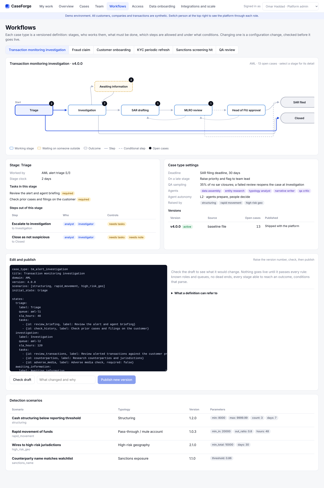

# CaseForge

A laptop-sized, working slice of an AI-first financial-crime case management platform. It ingests a bank feed,
maps it to a canonical model, runs monitoring scenarios, groups alerts into cases, has an agent prepare each
investigation, and routes the work through configurable workflows to the right people, under role, four-eyes
and stage-clock controls, with a complete audit trail.

This is a demo build. It is meant to be shown, not deployed. All data is synthetic.




## Run it on a Mac

Pick one. Both end at <http://localhost:8000>.

**Option A, Docker Desktop (Postgres):**

```bash
docker compose up --build
```

**Option B, no Docker (SQLite).** Needs [uv](https://docs.astral.sh/uv/) and Node 20+ (`brew install uv node`):

```bash
make run
```

The first start seeds about 300 customers, 34,000 transactions and 60 cases across monitoring, sanctions, fraud,
KYC and QA, already worked to different stages by twelve people. `make seed` (or `make reset` for
Docker) restores that starting point before each demo. `make test` runs the backend tests.

For development, run `make dev-api` and `make dev-ui` in two terminals and open <http://localhost:5173>.

## A fifteen-minute demo

The person picker at the top right is the whole login. Each step below says who to be.

1. **My work, as Ivan Petrov (L2 investigator).** His own cases ordered by urgency, then unassigned work in
   his queue with a Claim button. Stage clocks and the regulatory deadline are separate columns.
2. **An investigation, still as Ivan.** Open a case in *Investigation*. The agent briefing is on the left with
   its recommendation and cited findings; click a "sources" chip and the transactions filter to the rows
   behind it. On the right, the steps are blocked until the stage tasks are ticked. Raise an information
   request to the customer and park the case: it moves to a waiting stage with its own clock.
3. **Approval, as Maya Chen (MLRO).** Open a case in *MLRO review*. An ordinary filing shows "Approve and file
   SAR". A case over $100,000 or on a politically exposed customer shows "Approve and send to Head of FIU"
   instead: the workflow itself routes it to a second approver (Hugo Laurent). Four-eyes rules stop anyone
   approving work they drafted or sent.
4. **Fraud, as Fran Dubois.** A different workflow on the same engine: a two-hour triage clock, customer
   contact as a waiting stage, and refunds above $5,000 routed to a lead (Tara Singh) for approval.
5. **Team, as Tara Singh (team lead).** Workload by person, queue backlogs, every case past its stage clock,
   and reassignment in one click. QA results sit alongside: one sampled closure failed QA and was reopened.
6. **Workflows, as Omar Haddad (admin).** Pick a case type and read it as a diagram with live case counts.
   Edit the definition (say, change the triage clock from 48 to 12 hours and raise the version), check the
   draft to see exactly what would change, and publish. New cases use the new version; open cases finish
   on the one they started with. A broken draft (unknown role, dead-end stage, bad condition) is refused
   with the reason.
7. **Access, as anyone.** The role and permission matrix, and every workflow step against every role. All of
   it comes from one policy file, `backend/access/default.yaml`.
8. **Read-only, as Audra Klein (auditor).** Every case and audit trail opens; nothing can be changed.
9. **Data onboarding and scale, as Omar.** Profile the legacy extract, confirm the mapping, load it: counts
   reconcile, defective rows are held, new cases appear. Then the throughput check and the laptop-to-cloud
   table on the last page.

To show overlay mode (sitting on top of an incumbent monitoring engine), push an alert from a terminal and
watch a case appear:

```bash
curl -X POST localhost:8000/api/alerts -H 'content-type: application/json' -d '{
  "source": "legacy-tm", "external_id": "LT-88213", "scenario": "rapid_movement",
  "party_id": "P10005", "score": 0.82, "explanation": "Vendor rule 12: funds in and out within 24h"}'
```

The full API reference is at <http://localhost:8000/docs>.

## What is real and what is not

| Area | In this build | Not yet |
|---|---|---|
| Ingestion | CSV feeds, profiling, mapping proposals, code-list translation, rejects, reconciliation | Streaming, CDC, ISO 20022 |
| Detection | Four scenarios (structuring, rapid movement, high-risk geography, watchlist name match), versioned and idempotent | Stream processing, ML models, a real sanctions list (the watchlist is fictional) |
| Alert intake | `POST /api/alerts` for outside engines, deduplicated, grouped per customer | Vendor-specific adapters |
| Workflows | Six case types as versioned YAML: stages, queues, stage tasks, conditional steps, waiting stages, four-eyes, stage clocks with escalation, QA sampling with reopen. Checked and published from the UI. | Durable workflow engine (timers are swept, not scheduled), parallel branches, a drag-and-drop designer |
| People and access | Twelve people in eleven roles, queues, claim and reassign, permissions and read-only access, all from one policy file. Every person is tested against every workflow step. | SSO, per-client policies, attribute-based rules, editing the policy in the UI |
| Information requests | Requests to customer, branch or relationship manager with due dates and overdue flags | Actually sending them (email, portal, secure message) |
| Agents | Multi-step investigation with cited findings, recommendation and draft narrative. Agents never move a case. | A language model. The provider is an offline rule-and-template implementation behind the `LLMProvider` interface, so the demo runs with no keys and no data leaving the laptop. |
| Filing | A hashed JSON filing record | FinCEN BSA XML, goAML |
| Identity | Person picker (no login) | SSO |
| Clients | One client | Multi-tenancy: next milestone |
| Scale | Measured single-process throughput on your machine | Anything distributed. Do not quote the laptop figure as a production figure. |

## How the code is laid out

```
backend/app/
  domain/      canonical model, access policy
  ingest/      connectors, mapping proposer, load and reconcile
  detection/   scenario registry and engine
  alerts/      alert hub: dedupe, group into cases, prioritise
  cases/       case type registry, transition guards, conditions, tasks, assignment,
               information requests, timers, QA sampling, publishing
  agents/      provider interface, investigation steps, orchestrator
  reporting/   dashboard metrics
  api/         HTTP routes (the UI uses only these)
backend/case_types/   one YAML file per workflow
backend/access/       the access policy: permissions, roles, queues, people
frontend/src/         React + TypeScript UI
```

Each replaceable part sits behind a small interface (`Connector`, `MappingProposer`, `LLMProvider`, the scenario
registry), so later milestones swap implementations without touching callers. The database is chosen by
`DATABASE_URL`; nothing in the code is tied to a cloud.

## Milestones

**1. Working slice (done).** One process, one database, end-to-end story across ingestion, detection, cases,
agents and reporting.

**2. Workflows and people (done).** The workflow engine, twelve people, queues, access policy, fraud and
onboarding journeys, QA, the workflow diagram and editor.

**3. Multi-tenancy.** Onboard a new client in minutes: isolated data, its own workflows, access policy and
people, a client switcher, and an operator console for running five to ten clients side by side.

**4. Ask anything.** Agents that answer questions across the whole caseload in plain language, through
governed queries, citing the cases behind every figure and limited to what the asker may see. Brings the model
gateway with hosted and local models.

**5. Data pipelines.** Sources in object storage (S3, ADLS, GCS) behind one cloud-neutral interface, scheduled
pipelines, saved mappings per source, data-quality gates and lineage. File upload remains only for samples.

**6. Enterprise breadth.** Entity resolution and a network view, search, regulatory filing formats, lookback
projects, management reporting, SSO.

**7. Production backbone.** Kafka, Temporal, Flink, a Helm chart, then the cloud build on the reference
architecture: per-client stamps and the SaaS, dedicated, client-cloud and air-gapped deployment modes.

## Screenshots

`node scripts/screenshots.mjs` regenerates `docs/screenshots/` from a running app (needs Playwright).
