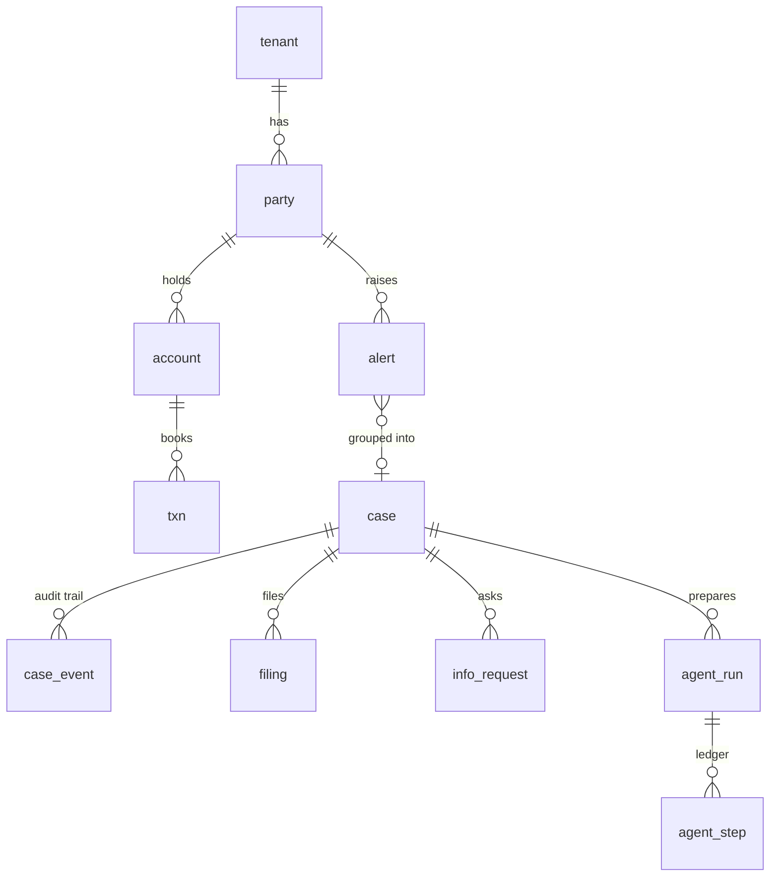

# Data model

The operational store is one relational schema defined in SQLAlchemy (`backend/app/domain/models.py`) and created by
Alembic migrations (`backend/app/migrations`). Every business table except `tenant` carries `tenant_id`; the
tenancy layer (`backend/app/tenancy.py`) filters every query and stamps every write with it, and refuses a statement
it cannot filter. Customer, account and transaction ids come from the client's own systems, so their keys include the
tenant (`TenantKeyed`); rows the platform creates use a prefixed random id (`TenantScoped`).

## The spine

A bank's data becomes a regulator's report through one chain of tables:

| Table | Holds |
|---|---|
| `tenant` | A client: template, region, deployment mode (pooled, dedicated, client-cloud), status, case types, settings |
| `party` | A customer: kind, name, country, occupation, risk rating, politically exposed flag, onboarding date |
| `account` | Product and status, under a party |
| `txn` | Time, amount, currency, direction, channel (cash, wire, ACH, card, P2P), counterparty and country, source feed |
| `alert` | Scenario and version (or outside source), score, explanation, transaction ids, dedupe key (unique per client), triage result, hibernation clock, agent closure and QA sample |
| `case` | Case type and version, stage, queue, owner, priority, stage and regulatory deadlines, disposition, narrative, agent recommendation, restriction, parent case, workflow working data |
| `case_event` | Append-only history: who (person, agent or system), what, when, payload. Never updated or deleted |
| `filing` | A regulatory report: format, status from prepared to accepted or rejected, document hash, regulator reference, amendment chain |
| `info_request` | A request to a customer, branch or relationship manager with a due date |

## By area

| Area | Tables |
|---|---|
| Versioned client configuration | `workflow_version`, `access_policy_version`, `agent_policy_version`, `scenario_version`, `code_list` |
| Agents and Ask | `agent_run`, `agent_step` (hash-chained ledger), `agent_job`, `media_item`, `ask_log` |
| Data onboarding | `data_source`, `pipeline_run`, `ingested_object` (load-once fingerprints and lineage), `feed` |
| Entities and network | `entity`, `entity_edge`, `match_candidate` |
| KYC | `risk_assessment`, `ownership_structure`, `evidence`, `kyc_trigger` |
| Sanctions and fraud | `watchlist`, `watchlist_entry`, `screening_exemption`, `hold`, `dispute`, `info_share` |
| Detection governance | `scenario_version`, `lookback` |
| Governance | `access_review` |
| Event backbone and stream jobs | `outbox_event`, `stream_stat`, `stream_job_run` |

## Events

Every audit event and every new alert is also written to `outbox_event`, as a CloudEvents 1.0 message, in the same
transaction as the change. Published by the relay or by Debezium, they reach each client's own topics:

| Topic | Direction | Content |
|---|---|---|
| `caseforge.<client>.case-events` | out | Every case event |
| `caseforge.<client>.alerts` | out | Every new alert |
| `caseforge.<client>.transactions` | in | Canonical transactions, loaded in micro-batches through the same loaders and detection as files |
| `caseforge.<client>.alerts-in` | in | Alerts from outside engines and the Flink jobs |
| dead-letter topic per client | out | Records that could not load, with the reason |

With `LAKE_CATALOG` set, the case-event, alert and transaction topics are also written to Apache Iceberg tables in
the client's own namespace, partitioned by day, committed with the bus positions so each message is written once.

## Rules for changing the model

- Every model change needs a migration: `make migration m="what changed"`. CI fails otherwise
  (`python -m app.migrate check`).
- A new tenant-scoped table must be added to the tenancy test factory in `backend/tests/test_tenancy.py`.
- Configuration is never edited in place: each publish is a new version, and work in flight keeps its own.
- Synthetic data is deterministic: ids come from `repeatable_ids`, and side data goes inside `side_ids(seed)`.
- Customer address, date of birth and identifiers are not held yet; reports mark those fields unknown.
